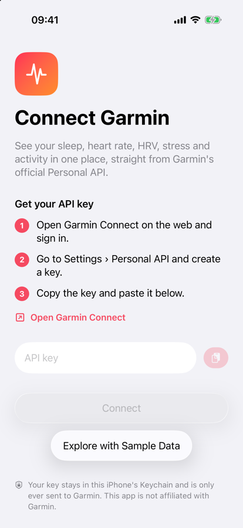
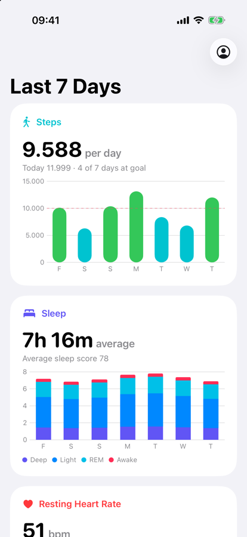

# gcpapi-sync-ios

[](https://github.com/thomascamminady/gcpapi-sync-ios/actions/workflows/ci.yml)


An open-source iPhone app for your Garmin health data, built on Garmin's official
[Personal API](https://developer.garmin.com/gc-developer-program/personal/personal-faq/) and
[gcpapi-sync-swift](https://github.com/thomascamminady/gcpapi-sync-swift).

<p>
  
  
</p>

> **Disclaimer.** This is a personal, private project. It is not affiliated with, endorsed
> by, or developed on behalf of my employer, Wahoo Fitness, and it is not affiliated with or
> endorsed by Garmin. "Garmin" and "Garmin Connect" are trademarks of Garmin Ltd. or its
> subsidiaries. The screenshots show the app's synthetic sample data.

## What it does today

- **Connect** with a Personal API key (Garmin Connect → Settings → Personal API). The key is
  checked with Garmin, then kept in this iPhone's Keychain: never synced to iCloud, never in
  backups, only ever sent to Garmin. Access tokens are cached in the Keychain too.
- **The last 7 days at a glance**: steps against your goal, sleep stages and score, resting
  heart rate, HRV with Garmin's status, VO2max, Body Battery range, stress, and intensity
  minutes against the weekly goal of 150.
- **Trends**: HRV, resting heart rate, sleep score, stress and VO2max on one chart, each
  scaled to 0–1 over the range shown, to see how they move together. Over 30 and 90 days, a
  7-day average smooths out single days; *Higher Is Better* flips resting heart rate and
  stress so that up always means a better day.
- **Detail screens** for every metric over 7, 30 or 90 days: scrub through the chart, see
  every day's value, and read what the metric means.
- **VO2max from your runs**: the Personal API does not return Garmin's VO2max, so it is
  estimated like Runalyze does: the oxygen cost of each run's grade-adjusted pace (Daniels and
  Gilbert) over the share of VO2max its average heart rate implies (Swain et al.), averaged
  over 30 days and weighted by duration.
- **Training**: Garmin's training load of every activity turned into fitness (six-week
  average), fatigue (one-week average) and form, with form zones that say whether you are
  building fitness, fresh, or overreaching; weekly hours by sport; and every activity of the
  last 90 days, searchable and filterable, with Garmin's training effect, primary benefit and
  time in heart rate and power zones.
- **Explore with sample data** without an account, also used for previews, screenshots and
  App Review.

## Under the hood

- SwiftUI for iOS 26 (Liquid Glass), Swift Charts, `@Observable` models.
- Swift 6 language mode with complete concurrency checking, *approachable concurrency* and
  main-actor isolation by default; non-UI code opts out explicitly with `nonisolated`.
- Data comes from [gcpapi-sync-swift](https://github.com/thomascamminady/gcpapi-sync-swift):
  typed `Codable` models for every Personal API endpoint, retries, token handling. The week
  is fetched with three concurrent requests.
- Errors are translated into what a person can do about them (offline, key rejected,
  Garmin unavailable, ...); a failed refresh keeps the data on screen.
- No tracking and no data collection (see `App/Resources/PrivacyInfo.xcprivacy`).

```text
App/
  Auth/       Keychain storage, the Keychain token cache, the session, the connect screen
  Health/     the week's data model and loader, the dashboard, charts
  Settings/   account and about
  Shared/     problem descriptions, formatting, the demo transport
AppTests/     Swift Testing tests (Keychain, session, loading, mapping, formatting)
```

## Building

Requirements: Xcode 26 or newer, an iOS 26 simulator or device.

```text
git clone https://github.com/thomascamminady/gcpapi-sync-ios.git && cd gcpapi-sync-ios
open GCPAPISync.xcodeproj
```

Run the `GCPAPISyncApp` scheme; launch with `-demo` to start in sample-data mode.

To run on an iPhone, put your team ID in `Config/Signing.local.xcconfig` (ignored by git), then
pick the phone as the run destination:

```text
echo 'DEVELOPMENT_TEAM = ABCDE12345' > Config/Signing.local.xcconfig
```

A free Apple Account works: its Personal Team ID is shown in Xcode under *Settings → Apple
Accounts*. The phone needs Developer Mode (*Settings → Privacy & Security*), and apps signed by a
Personal Team must be trusted once under *Settings → General → VPN & Device Management* and
run for seven days before they need to be installed again.

The Xcode project is generated from `project.yml` with [XcodeGen](https://github.com/yonaskolb/XcodeGen)
(`brew install xcodegen && xcodegen generate`) and committed for convenience; source folders
are synchronized, so adding files needs no project change.

## Quality bar

The same as gcpapi-sync-python and gcpapi-sync-swift:

- swift-format (`--strict`) and SwiftLint with every opt-in rule; rules are disabled only
  where they contradict swift-format or idiomatic Swift, each with its reason.
- Warnings are errors; no suppression comments or concurrency escape hatches
  (`swiftlint:disable`, `@unchecked Sendable`, `nonisolated(unsafe)`, `@preconcurrency`).
- Tests run on the iOS simulator in CI; pre-commit hooks run the same checks locally:

```text
brew install pre-commit swiftlint xcodegen && pre-commit install
Scripts/test.sh
```

## Roadmap

Ideas for what comes next: maps and laps for activities, background refresh with widgets,
HealthKit export, and ranges beyond 90 days.

## License

[MIT](LICENSE)
